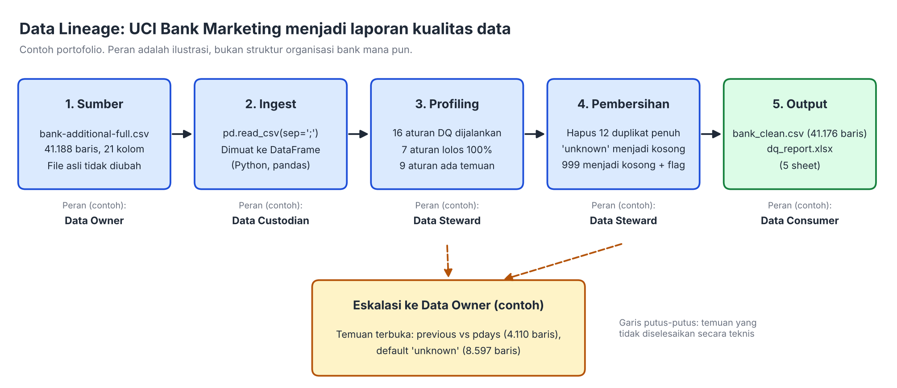

# Data Quality Assessment: UCI Bank Marketing

Proyek portofolio Data Governance: menilai kualitas data pemasaran bank dengan 16 aturan, membersihkan data secara terdokumentasi, lalu menyusun kamus data berklasifikasi, diagram lineage, dan SOP pengelolaan kualitas data.

> **Catatan penting:** proyek ini memakai data publik UCI Bank Marketing (bank di Portugal), bukan data atau proses bank mana pun di Indonesia. Aturan, ambang batas, peran, dan klasifikasi adalah usulan penulis untuk latihan, bukan standar resmi.

## Ringkasan

| Item | Nilai |
|---|---|
| Data yang dinilai | 41.188 baris, 21 kolom |
| Aturan kualitas data | 16 (keunikan, kelengkapan, validitas, konsistensi) |
| Aturan lolos 100% | 7 |
| Temuan tercatat | 8 (2 berprioritas tinggi) |
| Data setelah pembersihan | 41.176 baris |



## Temuan

| # | Dimensi | Temuan | Skala | Prioritas | Status |
|---|---|---|---|---|---|
| 1 | Kelengkapan | `default` berisi "unknown" | 8.597 baris (20,87%) | Tinggi | Didokumentasikan |
| 2 | Konsistensi | `previous` > 0 tetapi `pdays` = 999 | 4.110 baris (9,98%) | Tinggi | Terbuka, dieskalasi |
| 3 | Kelengkapan | `education` berisi "unknown" | 1.731 baris (4,20%) | Sedang | Didokumentasikan |
| 4 | Kelengkapan | `housing` dan `loan` berisi "unknown" | 990 baris masing-masing (2,40%) | Sedang | Didokumentasikan |
| 5 | Validitas | `pdays` memakai kode 999 | 39.673 baris (96,32%) | Sedang | Diperbaiki (representasi) |
| 6 | Kelengkapan | `job` berisi "unknown" | 330 baris (0,80%) | Rendah | Didokumentasikan |
| 7 | Kelengkapan | `marital` berisi "unknown" | 80 baris (0,19%) | Rendah | Didokumentasikan |
| 8 | Keunikan | Baris duplikat penuh | 12 baris (0,03%) | Rendah | Dihapus (dengan asumsi) |

Detail, catatan keterbatasan, dan rekomendasi ada di [`Temuan_DQ.md`](Temuan_DQ.md).

## Isi repositori

| File | Keterangan |
|---|---|
| `dq_project.py` | Script Python: menjalankan 16 aturan, membersihkan data, membuat laporan |
| `dq_report.xlsx` | Laporan hasil (5 sheet: Ringkasan, Kamus_Data, Hasil_Aturan_DQ, Log_Pembersihan, Lineage) |
| `Kamus_Data_Lengkap.xlsx` | Kamus data 21 field dengan kategori data pribadi (UU PDP) dan klasifikasi |
| `Temuan_DQ.md` | Laporan temuan berprioritas |
| `SOP_Kualitas_Data.pdf` | SOP Pengelolaan Kualitas Data |
| `docs/lineage.png` | Diagram lineage |
| `requirements.txt` | Pustaka Python yang dibutuhkan |

## Cara menjalankan

1. Unduh dataset **Bank Marketing** dari UCI Machine Learning Repository, lalu ambil `bank-additional-full.csv` (pemisah titik koma). Dataset tidak disertakan di repositori ini.
2. Pasang pustaka:

```bash
pip install -r requirements.txt
```

3. Jalankan script dengan path ke file data:

```bash
python dq_project.py data/bank-additional-full.csv
```

Keluaran (`dq_report.xlsx` dan `bank_clean.csv`) dibuat di folder tempat script dijalankan. Script juga bisa dijalankan di Google Colab: unduh dataset dengan `wget`, unggah `dq_project.py`, lalu jalankan dengan `!python`.

## Metode

- **Dimensi:** keunikan (1 aturan), kelengkapan (6), validitas (7), konsistensi (2).
- **Prinsip pembersihan:** file asli tidak diubah, setiap perubahan dicatat di log, dan nilai yang tidak diketahui tidak diisi tebakan.
- **Yang dilakukan pembersihan:** menghapus duplikat penuh, mengubah "unknown" menjadi nilai kosong, dan mengubah kode 999 pada `pdays` menjadi nilai kosong dengan kolom penanda `pernah_dikontak_sebelumnya`.

## Keterbatasan

- **Perbaikan kode 999 hanya mengubah representasi.** Itu tidak menambah informasi baru, jadi angka 100% sesudah perbaikan tidak berarti kualitas sumber membaik.
- **Temuan 2 belum diketahui penyebabnya.** Kedua kolom mungkin mengukur periode berbeda; hal itu tidak dapat dipastikan dari data dan perlu dikonfirmasi pemilik data.
- **Penghapusan duplikat adalah asumsi.** Dataset tidak memiliki ID nasabah, sehingga baris identik bisa saja nasabah berbeda.
- **"Unknown" tidak diimputasi.** Maknanya (tidak menjawab atau tidak tercatat) tidak diketahui.
- Klasifikasi data pribadi merujuk Pasal 4 UU No. 27 Tahun 2022; penempatan `default`, `housing`, dan `loan` sebagai data keuangan pribadi adalah interpretasi penulis dan bukan nasihat hukum.
- Penilaian dilakukan pada satu versi data, tanpa pembanding antarwaktu.

## Sumber data

UCI Machine Learning Repository, *Bank Marketing* (Moro, Cortez, dan Rita, 2014). Periksa halaman dataset untuk lisensi dan sitasi resmi sebelum memakai ulang.

## Penulis

Zulfa Malika Amana, Data Analyst dan mahasiswa S2 Magister Ilmu Komputer (Teknologi Sistem Informasi), Universitas Budi Luhur.
